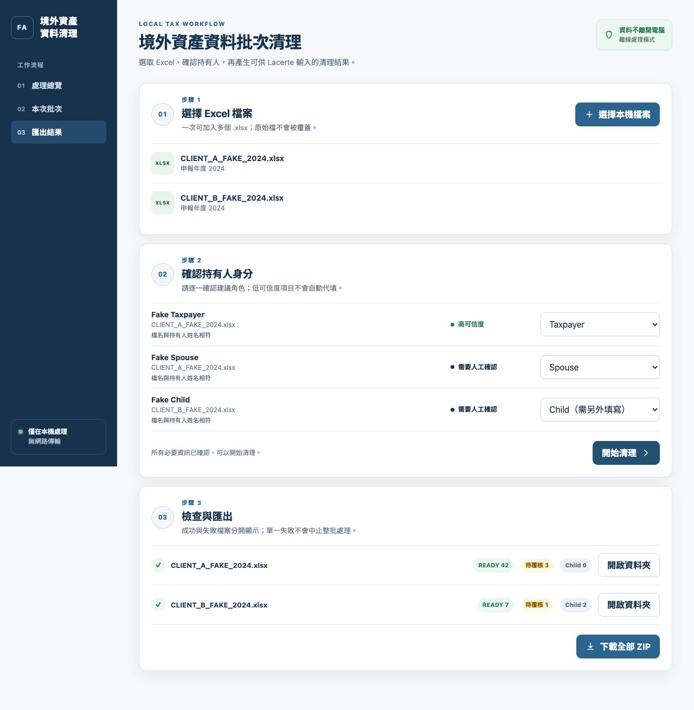
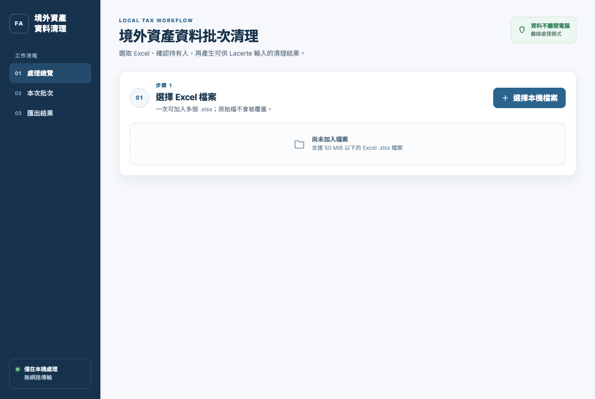
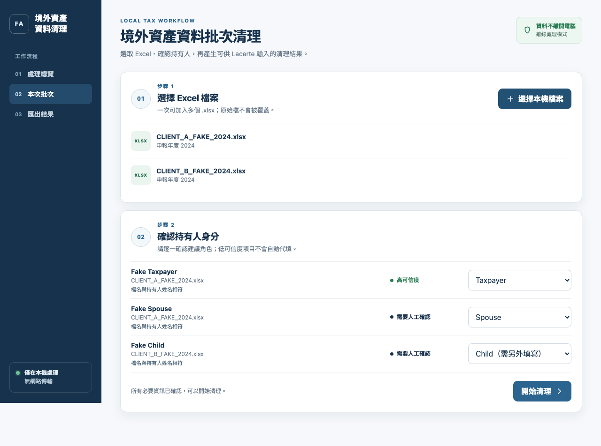

# Foreign Asset Excel Cleaner

**An offline desktop app that turns clients' messy foreign-account spreadsheets into review-ready worksheets for US tax filing (Form 8938 and FinCEN 114), built during my internship at a US CPA firm.**

會計師事務所實習時做的離線桌面工具：把客戶的境外帳戶 Excel 整理成可直接覆核、輸入 Lacerte 的工作表。

> **Type** Internship (tax and digital transformation intern, 四海會計師事務所 / Hsu, Yao, Thuang & Chiang CPAs, USA) · **Status** Prototype complete on macOS (2026-07), not deployed · **Role** Solo project · **Stack** Python, openpyxl, React + TypeScript, pywebview, PyInstaller (macOS and Windows)

## Background

The firm receives clients' foreign bank and asset details in Excel files with roughly fixed columns, but the content is messy: Chinese and English mixed together, inconsistent capitalisation, addresses in one cell, account numbers turned into scientific notation by Excel, merged cells, and currency mixed into notes. Staff cleaned each file by hand before typing it into Lacerte, which was slow and invited copying errors.

## What it does

- **Keeps the original sheets** and adds a reviewable `CLEANED <year>` sheet next to them; nothing is overwritten.
- **Normalises bank names and addresses**: upper-case English names split to Lacerte's 34-character lines without breaking words, and addresses split into street, city, state, postal code and ISO country code.
- **Maps account types** to the firm's Form 8938 and FinCEN 114 categories, and converts the highest balance with the IRS yearly average rate while keeping the full calculation trail.
- **Flags owners** as taxpayer, spouse, child or "needs review", and marks anything uncertain instead of guessing.
- **Processes a batch** of files at once and exports a ZIP of the cleaned workbooks.

| 1. Select Excel files | 2. Confirm each owner |
| --- | --- |
|  |  |

## Key decisions

| Decision | Why |
| --- | --- |
| Runs fully offline: the interface is locked to no network access, and a script verifies the built app opens no connections | Client tax data must never leave the staff member's computer. |
| No AI and no web lookups for banks, addresses or tax treatment | Wrong guesses in a tax filing are costly; uncertain items go to a CPA for review instead. |
| Low-confidence owners are never auto-filled | Taxpayer, spouse and child accounts are reported differently, so a person confirms each one. |
| Files in OneDrive, iCloud, Dropbox or Google Drive are skipped unless the user confirms firm policy allows them | Sync folders can copy client data to the cloud without anyone noticing. |
| Packaged as a double-click app for macOS and Windows | Tax staff should not need Python, Node or a terminal. |

## Results

- The Mac app was built and launched on a real machine; the Windows build script and acceptance checklist are ready.
- 200+ automated tests (Python and UI), plus a script that checks the built Mac app opens no network connections.

## Notes

The source code is private because the tool was built for client tax data. All screenshots use fake files and fake people; the counts shown are sample values. This tool organises data only; it does not replace a CPA's review, decide filing obligations, or enter data into Lacerte.

## 中文摘要

在美國會計師事務所實習時，為報稅流程做的離線桌面工具。客戶提供的境外帳戶 Excel 欄位雖固定，但中英文混用、地址沒拆欄、帳號被 Excel 轉成科學記號，過去要人工清理後再輸入 Lacerte。這個工具保留原始工作表，另建可覆核的清理結果：銀行名稱與地址標準化、帳戶類型對應 8938 與 114 分類、用 IRS 年平均匯率換算，並把不確定的資料標出來交給會計師。全程在本機執行，不連網。原始碼因涉及客戶稅務資料不公開，截圖全為假資料。
